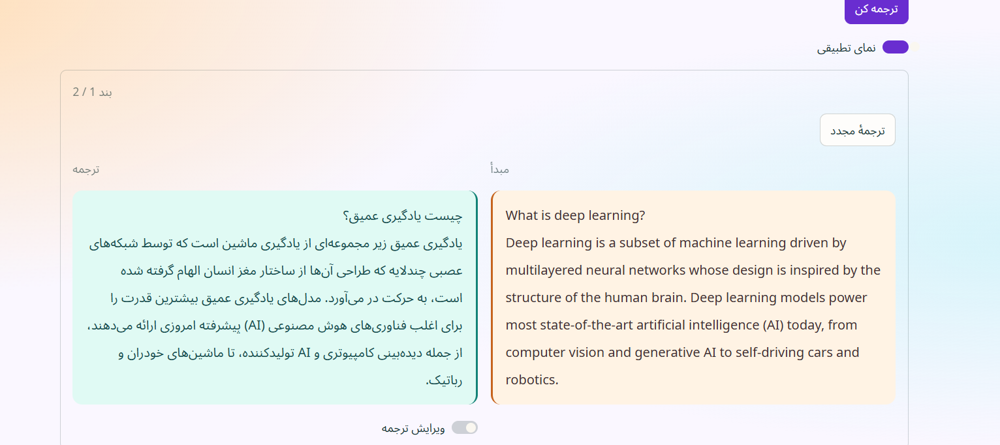

# VajehNegar · واژه‌نگار

A local English–Persian translation editor and bilingual dictionary built with Streamlit and Ollama. Compare each passage with its translation, revise individual passages, and evaluate two prompts without seeing their names.

[راهنمای فارسی](README.fa.md)

## Developed by

| Role | Name |
| --- | --- |
| Student developer | Anita Bakhshi · آنیتا بخشی |
| Instructor | Dariush Tasdighi · داریوش تصدیقی |
| Course | LLMOps |



## Features

- Translate in either direction, independently of the interface language.
- Choose automatic, dictionary, or text mode. Supply custom terminology as one `source = target` mapping per line.
- Compare, edit, regenerate and download passages. Resume an interrupted translation in the same Streamlit session.
- Inspect token counts, elapsed time and warnings for detectable differences in numbers, percentages and identifiers.
- Run 30 bilingual evaluation cases. Score randomized A/B responses for fidelity and fluency, reveal prompt identities after locking ratings, and export the results as CSV.

## Main packages

| Component | Purpose |
| --- | --- |
| Streamlit | Bilingual editor and evaluation interface |
| Ollama Python client | Local model inference |
| python-dotenv | Optional configuration from a local environment file |
| Rich | Terminal formatting in the course utility module |

## Setup environment

Install Python 3.12 and [Ollama](https://ollama.com/). Start Ollama, open a terminal in the project root and download the default model once.

```shell
ollama pull qwen3:8b
```

**Windows PowerShell**

```powershell
py -3.12 -m venv .venv
.\.venv\Scripts\python.exe -m pip install -r requirements.txt
.\.venv\Scripts\python.exe -m streamlit run streamlit_app.py
```

**Linux / WSL**

```bash
python3.12 -m venv .venv
.venv/bin/python -m pip install -r requirements.txt
.venv/bin/python -m streamlit run streamlit_app.py
```

Open the local URL printed by Streamlit. With WSL, the application must be able to reach the Ollama server at the configured address.

## Optional configuration

Copy `.env.example` to `.env` to override the defaults. Local inference requires no API key.

```dotenv
OLLAMA_HOST=http://127.0.0.1:11434
OLLAMA_MODEL=qwen3:8b
```

## Evaluate a translation

Try “Revenue may fall by 12%.” Check that the translation preserves uncertainty, the direction of change and the percentage. Literal checks cover only detectable forms. Fidelity and fluency are scored by a human. Export translations and evaluation results before closing the session.

## Project layout

| Path | Contents |
| --- | --- |
| `streamlit_app.py` | Editor, session state and blind evaluation |
| `translator.py` | Prompt versions, passage splitting and model calls |
| `quality.py` | Literal consistency checks |
| `cases.tsv` | 15 English and 15 Persian evaluation cases |
| `assets/` | Local fonts, font attribution and interface styles |
| `dt_lm.py`, `dt_utility.py` | Course utility modules by Dariush Tasdighi |

## Acknowledgments

The configuration and model-client patterns draw on Dariush Tasdighi’s teaching materials, including the [dotenv reference project](https://github.com/Dariush-Tasdighi/DT_LEARNING_PYTHON_DOTENV) and the Streamlit course archive. Bundled Noto font notices are in [assets/FONT-LICENSE](assets/FONT-LICENSE).
